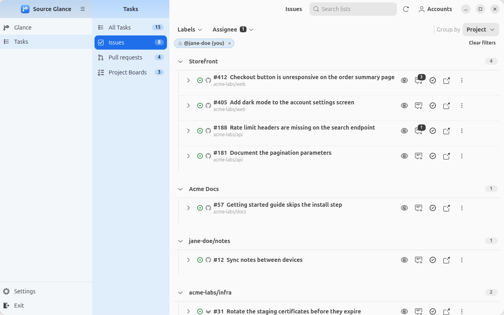
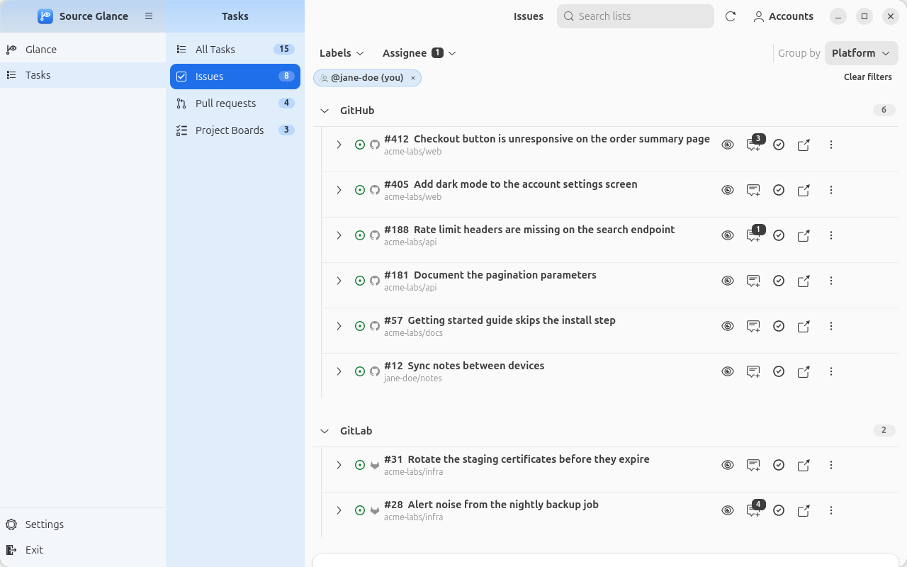
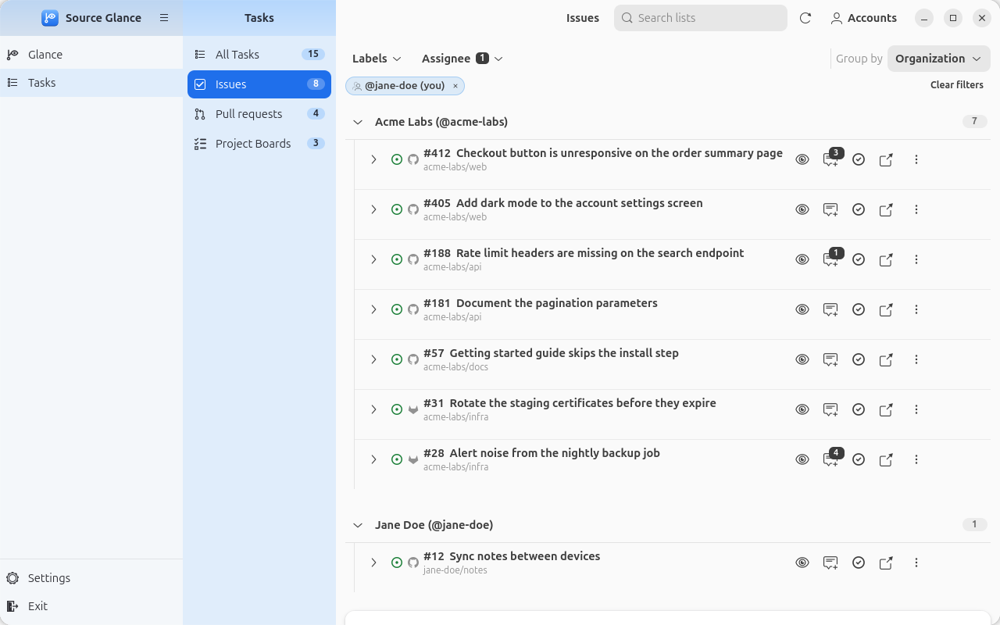
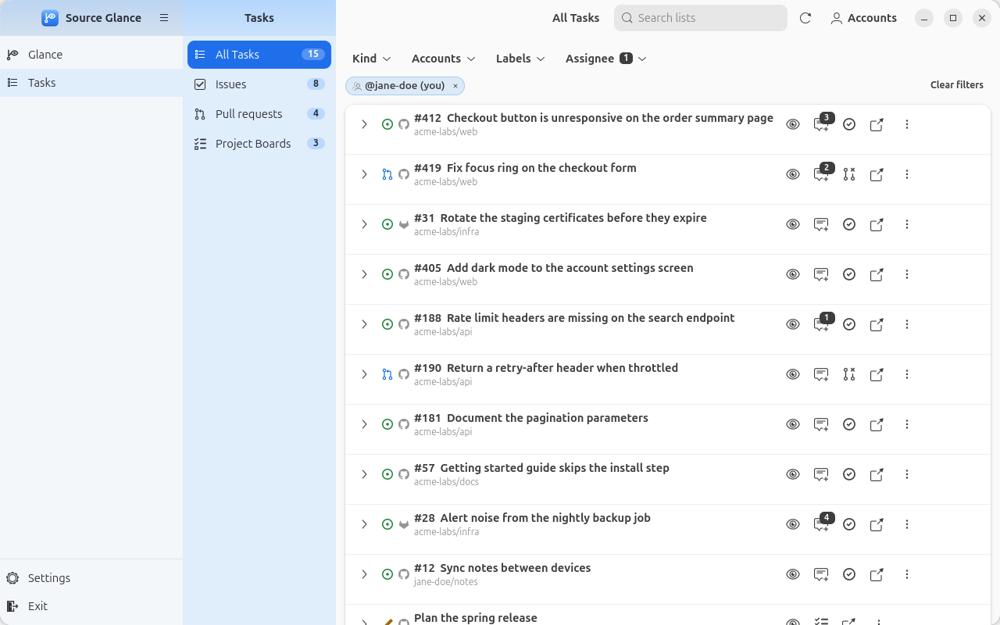
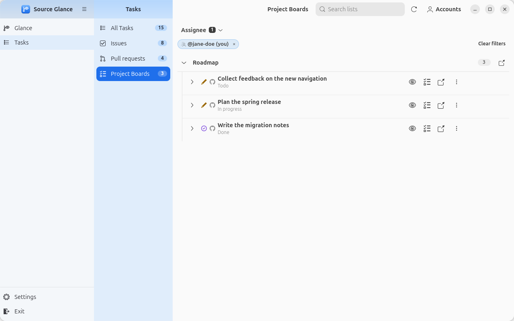
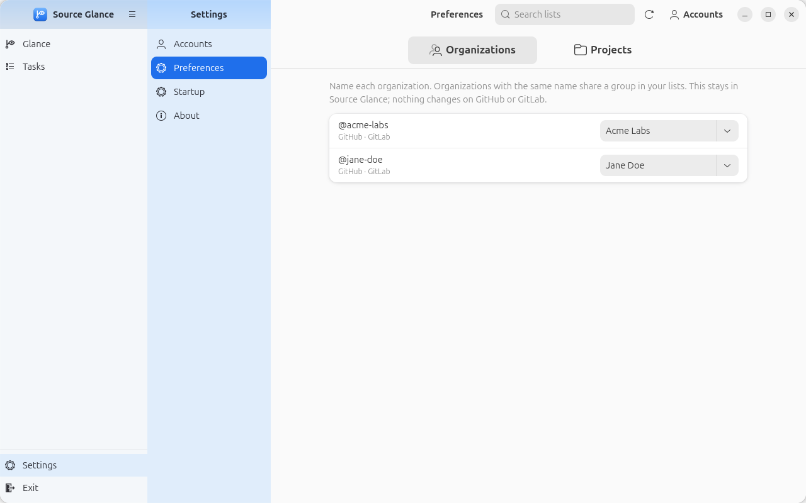

# sourceglance

**Your GitHub and GitLab issues, pull requests and project boards, one glance away: in the
Ubuntu top bar, in their own window, and right on your desktop.**

[](LICENSE)
[](https://github.com/omer-gh/sourceglance/actions/workflows/lint.yml)
[](src/metadata.json)
[](https://github.com/omer-gh/sourceglance/releases)

**Home page and download: <https://omer-gh.github.io/sourceglance/>** ·
Made by **Mohammad Omer** ([@omer-gh](https://github.com/omer-gh))

Source Glance is a GNOME Shell extension for Ubuntu Desktop. It shows what's assigned to you
on GitHub and gitlab.com, and lets you act on it, without opening a browser:

- **Top-bar buttons** for Issues, Pull requests and Project Boards, each with a live count.
- **Desktop widgets**: cards with your lists, pinned to the desktop under your windows.
- **A main window** with every list, a search box, and all settings in one place.
- **One-click updates**: a verified download, applied without logging out.

> **Status: early releases.** v0.12.1 is the latest, published as a pre-release. Try it, and
> [report anything odd](https://github.com/omer-gh/sourceglance/issues).

## Screenshots

Made with invented accounts and items; nothing here is real data.



Group by **Project**, **Platform** or **Organization**: one flat list across all your accounts.

| By platform | By organization |
| --- | --- |
|  |  |

| All Tasks | Project Boards |
| --- | --- |
|  |  |



## Features

- **Desktop widgets**: Summary, Issues, Pull requests and Project Boards cards on your desktop.
  Drag them anywhere, set their opacity, click an item to open it. Apply the wallpaper
  they're made for (GNOME's Adwaita) in one click, and Reset to put yours back.
- **Top bar**: buttons for Source Glance, Issues, Pull requests and Project Boards as one tinted
  group or as tabs in one menu, each with its count (0 included). The menus have a steady
  width that fits your screen.
- **Act from anywhere**: comment, close or reopen, edit assignees and labels, and move
  items between statuses on your project boards, from the menus or the window.
- **Custom fields**: an item's ⋮ menu in the window ends with its custom fields, under
  **Custom fields**: GitHub issue fields, the fields of every project board it's on, and
  GitLab custom fields. Each type gets its own control right there: an entry for text, numbers
  and dates (saved on Enter), a drop-down for one choice or an iteration, and check boxes for
  several choices. A change is saved at once.
- **Preview and edit in the window**: read an item's description, comments and reactions,
  edit the description and add a comment, all with a small Markdown editor. The preview
  reads like a web page: the item's kind as a coloured icon in its header, the description
  under its own heading, and comments as a feed with each author's avatar. Labels and
  assignees show as chips under the title: × removes one, + adds one.
- **Several accounts, self-hosted too**: add as many GitHub and GitLab accounts as you like.
  Their items show together in one list, in every list, menu and widget, and counts add up
  across all of them. The title bar's **Accounts** button opens a small card of your accounts;
  **Settings → Accounts** adds more, and its wizard connects GitHub Enterprise Server and
  GitLab self-managed.
- **Group by**: lists are one flat list across all your accounts, grouped by **Project**
  (the default), **Platform** or **Organization**, in the window, the top bar menus and the
  widgets. Choose it in a list's filter bar or in **Glance → System Tray**; Source Glance
  remembers it. Each row shows its repository under the title when the heading isn't it.
- **Organizations and projects**: **Settings → Preferences** has two tabs. **Organizations**
  lists every organization found for your accounts, each with a name you can type or pick
  (the lists show **Name (@login)**; organizations with the same name are one group, even
  across platforms). **Projects** lists your repositories as projects: rename one with its
  pencil, drag repositories between projects, or disband a group. Names and projects stay
  in Source Glance; nothing changes on GitHub or GitLab.
- **Limit repositories & boards**: each GitHub account has a button that opens a panel over
  the page: where to widen or limit what the sign-in can reach on GitHub, **Watch
  repositories** (search public repositories to add; switch a whole organization's repositories
  off or on), and your project boards (hide the ones you don't want).
- **All Tasks**: everything assigned to you in one list, newest first, with the same actions
  as the lists. Filter it with **Kind**, **Accounts**, **Labels** and **Assignee**, each a
  check list; what you pick shows as chips below them, each removed with ×. **Assignee**
  starts as you. Check **Unassigned** or a teammate to see what's open across your
  repositories and organizations: the window loads the whole team's open items, so product
  managers, project coordinators and owners can follow a whole project. Issues and Pull
  requests have **Labels** and **Assignee** filters in the window, and Project Boards has
  **Assignee**.
- **Project Boards**: draft items on your GitHub Projects (v2) boards, grouped by status.
  Hide a board in **Limit repositories & boards**.
- **Search** from the window's title bar: one box filters Issues, Pull requests and Project Boards
  by title, repository, number, label, person or board status, with match counts. Clear it
  to see everything again.
- **Closed items**: see how many closed or merged items are still assigned to you.
- **Main window** with a slim sidebar: **Glance** (Widgets and System Tray) and
  **Tasks** (All Tasks, Issues, Pull requests, Project Boards), each opening its menu right
  beside it, then **Settings** (Accounts, Preferences, Startup, About) and **Exit** at the
  foot. The title bar's **Accounts** button opens your accounts. A splash screen and an app grid icon, all in the top bar's blue. It's an app of its own, so
  the dock and Alt+Tab show it as Source Glance.
- **Problems say how to fix them**: if an account's lists don't load, a red **!** on
  Refresh says why (sign-in rejected, no connection, request limit…) with a button that
  fixes it or tries again. With no account yet, a note under **Accounts** shows how to get
  started.
- **Public repositories** you don't own show up without any setup; private ones appear once
  their owner installs the Source Glance app.
- **Limited access**: on github.com, sign in through a GitHub App that can only see issues,
  pull requests and projects (no code), or with a token you create. Tokens stay in the GNOME
  keyring. Self-hosted instances need HTTPS unless they're on your local network.
- **Start automatically** at login, or **Quit** (in the window: **Exit**) and start it again
  from the app grid. The **Top bar** switch in **Glance → System Tray** turns the top bar,
  the desktop widgets and the refreshing off and on without closing the window.
- **One-file installer**: a setup wizard that installs, updates, repairs and removes
  Source Glance.
- **Update notice** at login when a new version is out, with short release notes, and
  **Update available** in the window: one click downloads the new Setup, checks its SHA-256
  checksum, and updates Source Glance without logging out.
- **About** (Settings → About) with the version, the update check right under it, the
  author, and links to report an issue or contribute.

Planned: desktop notifications for new assignments.

## Desktop widgets

Widgets put your lists on the desktop itself, so a glance at the desktop shows what's
waiting for you. They sit below your windows and above desktop icons, so they never cover
your work and stay clickable.

| Card | Shows |
| --- | --- |
| **Summary** | Open issues, pull requests and project drafts, plus closed and merged items still assigned to you |
| **Issues** | Open issues assigned to you, from GitHub and GitLab |
| **Pull requests** | Pull and merge requests assigned to you or awaiting your review |
| **Project Boards** | Draft items on your project boards, with their status |

- **Arrange them** in Source Glance → **Glance → Widgets**, which draws the cards on your
  wallpaper at their real size. Drag a card by its header to move it; the desktop shows them
  in that order. Summary is on by default.
- **Each card** has a size button (Small, Medium or Large) and a trash button in its header
  (the card waits under **Add widget**, where + brings it back) and, under its list, **On desktop** (off keeps it in the window
  only) and its own opacity slider. Custom widgets also have a gear for their settings.
- **All widgets**, the gear under the cards: every card on or off the desktop, one opacity
  and one size for all, where cards go on the desktop (top right, right, top, left or bottom), **Tidy
  up**, **Reset desktop positions**, and the background.
- **Custom widget**, under Add widget, makes a card of your own: a name, an icon, and
  filters (issues, pull requests or project drafts; account, repositories, labels, review
  requests, search words). It's kept in your settings, so it stays through updates.
- **Move a card on the desktop** by dragging its header; Source Glance remembers where you
  put it. **Reset desktop positions**, in All widgets, puts them back in the arrangement.
- **Wallpaper**, in All widgets: the cards are made to sit on Adwaita, GNOME's default
  wallpaper. **Apply** sets it and keeps yours; **Reset** puts yours back. Change the
  wallpaper any other way and only **Apply** is offered again.
- **Click an item** to open it in your browser. Each card shows when it was last updated
  and refreshes with the rest of Source Glance.

## Requirements

- Ubuntu 24.04 LTS or newer (or any distro with GNOME Shell 46–50)
- A GitHub or gitlab.com account

## Installation

### Setup wizard (recommended)

1. Download **Source Glance Setup** from the
   [home page](https://omer-gh.github.io/sourceglance/) or
   [Releases](https://github.com/omer-gh/sourceglance/releases): one `.AppImage` file
   (`x86_64` for most PCs, `aarch64` for ARM).
2. In Files, right-click it, choose **Properties** and turn on **Executable as Program**.
3. Double-click it and follow the wizard, then log out and back in.

No admin password, app store or apt/snap repository needed. The same Setup file installs,
updates, repairs and removes Source Glance. The [install guide](docs/installing.md) also
covers checking the download.

### Updating

When a newer version is out, a notification says so when you log in, with short release
notes; **Install** there opens the window and starts the update. The window also shows
**Update available** next to Refresh. Click it: Source Glance downloads the new Setup for your PC into a private temporary
folder, checks it against the release's `SHA256SUMS`, and opens it only if it matches. Setup
updates Source Glance in place and starts the new version straight away, with no log-out;
then the window reopens on the new version. You can also just download and run the latest
Setup yourself. Coming from v0.2.0 or earlier, log out once after this first update.

Turn the check off in **Settings → About → Check for updates** (right under the version). It only
asks GitHub for the list of Source Glance releases; nothing about you is sent.

### From source

```bash
git clone https://github.com/omer-gh/sourceglance.git
cd sourceglance
make install
```

Then log out and back in (on Wayland), and enable the extension:

```bash
gnome-extensions enable sourceglance@omer-gh.github.io
```

### Preview without installing for good

```bash
git clone https://github.com/omer-gh/sourceglance.git
```

```bash
cd sourceglance && ./tools/preview.sh
```

The script explains the risks, asks you to accept the [Apache License 2.0](LICENSE) (the software
comes with no warranty), and does any one-time setup. See
[docs/development.md](docs/development.md#preview-script-recommended).

### From extensions.gnome.org

Coming with the first stable release.

## Getting started

Open Source Glance from the app grid (or the Source Glance button in the top bar →
**Settings**), then go to **Settings → Accounts**:

1. Under **Add an account**, click **GitHub** and choose **Sign in with GitHub**. Source Glance
   copies a short code and opens GitHub; paste it and approve. This gives access to issues,
   pull requests and project boards only: no code, settings or admin access.
2. Press **Limit repositories & boards** on the account's row. The first link opens GitHub,
   where you pick which repositories the app may see. Under **Watch repositories** you can
   narrow what the lists show, or search for a public repository to add; leave everything
   on to see everything assigned to you.
3. Optionally, click **GitLab** and approve on gitlab.com the same way. GitLab sign-ins renew
   themselves in the background.

You can add several accounts of each, for example a personal and a work account. Their items
show together, and changes run as the account the item came from. Every
platform also takes a **personal access token**; each sign-in option says which repositories
it reaches.

**Self-hosted:** **Connect a self-hosted instance** adds GitLab self-managed or GitHub
Enterprise Server. Enter its address; Source Glance checks that it really is that platform,
then you sign in in the browser (with an app you register on the instance) or with a
personal access token. Use `https://`; plain `http://` only works for an instance on your
local network, checked each time Source Glance connects.

**Repositories owned by someone else:**

| Repository | Shows in Source Glance | Comment, close, labels, assignees, status |
| --- | --- | --- |
| Yours, with the app installed | Yes | Yes |
| **Public**, owned by someone else | Yes, without any setup | Only once the owner installs the app; until then, make changes on GitHub |
| **Private**, owned by someone else | Once the owner installs the app | Once the owner installs the app |

To install the app on a repository, its owner opens
<https://github.com/apps/sourceglance/installations/new> and picks the repository.
Organization repositories need an organization owner to install it.

## Using sourceglance

### Top bar

The top bar shows Source Glance's buttons as one tinted block, each list with its count:

- **Source Glance**: who you're signed in as, then **Glance**, **Tasks**, **Settings** (**Sign in…**
  when you're signed out) and **About**, each opening its page in the window, plus **Start
  automatically** and **Quit**. After Quit, start it again from the app grid icon.
- **Issues**: open issues assigned to you
- **Pull requests**: pull and merge requests assigned to you or awaiting your review
- **Project Boards**: draft items on your project boards, grouped by status

Each list is one flat list across all your accounts, grouped by the **Group by** you chose,
each group a plain heading with its count, and it ends with how many closed items are still
assigned to you. In **Glance → System Tray** you choose **Group by**, which lists to show,
and whether they're separate buttons or **tabs in one menu**.

The menus are about a quarter of your screen wide (28 %), never narrower than 360 or wider
than 560 pixels at 100 % scaling. The width is set when Source Glance starts and stays put
as lists load, refresh or switch tabs; it changes only when you change the screen
resolution or display scaling.

### Actions

Click any issue, pull request or merge request in a menu for its actions:

- **Open on GitHub** / **Open on GitLab**
- **Comment…**
- **Close…** (you confirm first; GitHub issues close as completed or not planned) and
  **Reopen**
- **Assignees…** and **Labels…**
- **Board: Status…** for each project board it's on

In the window, each row has its actions as icons on the title line (hover one for its name):

- **Preview**: opens a panel on the right of the window, beside the list, with the
  description, which you can edit, then the comments and reactions (read only) and a box to
  add a comment. The list shrinks first, down to a title at 40 characters, and the window
  grows only if it must. Drag its edge to resize it. It closes when you go to another page or
  work with another item. Project drafts show their description only.
- **Comment**, with the number of comments on the button's corner.
- **Close**, and a button for each project board it's on, to move it to another status.
- **Open** in your browser.
- The **arrow** shows or hides its labels and assignees, as chips: labels in their own
  colour. **×** removes one; **+** lists what you can add. Rows start collapsed.

Comments and descriptions are written with a small Markdown editor: bold, italic,
strikethrough, inline code, bulleted and numbered lists, quotes and code blocks, from the
toolbar or with Ctrl+B and Ctrl+I. Ctrl+Enter posts. Project drafts can be assigned (to you
or whoever is already on them) and previewed; GitHub drafts have no labels or comments.

### Main window

The sidebar is a slim column of icons, each with its name under it (☰ at its top shows full
names instead). Click one and its menu opens right beside it, with full names and counts:

- **Glance**, which opens first: **Widgets** and **System Tray**, both on one page, each
  under its own heading. System Tray previews both top-bar layouts as tiles; click a list on
  a preview to show or hide it.
- **Tasks**: **All Tasks**, then your **Issues**, **Pull requests** and **Project Boards**,
  each with its count (0 until they load) and the same actions as the menus.
- **Settings**, at the foot, with a page for each part: **Accounts** (and adding one),
  **Preferences** (big tabs for **Organizations** and **Projects**), **Startup** (start at
  login, the app grid icon) and **About** (the version, the update check right under it, the
  author, and links to report an issue or fork the repository and contribute).
- **Exit**, below it, stops Source Glance.

**Accounts**, in the title bar, opens a small card of your GitHub and GitLab accounts with
their status, and takes you to add or manage them. **Refresh**, beside it, reloads the lists; a red **!** on its
corner means an account's lists didn't load: point at it to see why and how to fix it.

**Search** the lists from the box on the right of the title bar, always there on every page
(or just start typing; Ctrl+F also jumps there). Searching from a settings page opens All
Tasks. It matches titles, repositories, `#numbers`, labels, people and board
statuses, across Issues, Pull requests and Project Boards at once. While you search, the Tasks
menu's counts and the title bar show how many items match. Clear the box, press Esc or click
**Clear search** to see your full lists and counts again; the list you're on stays selected.

## Roadmap

| Milestone | Goal |
| --- | --- |
| `v0.1.0` ✅ | Top bar, main window, desktop widgets, GitHub and gitlab.com, setup wizard |
| `v0.2.0` ✅ | About page: version, author, report an issue, fork and contribute |
| `v0.3.0` ✅ | Update button with verified downloads, updates without logging out, search, one Accounts page |
| `v0.4.0` ✅ | Search box always on the right of the title bar |
| `v0.5.0` | Desktop notifications for new assignments |
| `v1.0.0` | Published on extensions.gnome.org |

Details: [docs/product/roadmap.md](docs/product/roadmap.md).

## Contributing

Source Glance is open source, and your help makes it better.

- **Report an issue:** found a bug, have an idea or a question?
  [Open an issue](https://github.com/omer-gh/sourceglance/issues/new/choose). Include your
  Ubuntu and GNOME Shell versions, and what you expected to happen.
- **Contribute code or docs** by forking the repository:
  1. [Fork Source Glance](https://github.com/omer-gh/sourceglance/fork) to your account and
     clone your fork.
  2. Create a branch, make your change, and run `make lint` and `make test`.
  3. Push the branch to your fork and open a pull request against `main`.

  Start with [CONTRIBUTING.md](CONTRIBUTING.md), and look for issues labelled
  [`good first issue`](https://github.com/omer-gh/sourceglance/labels/good%20first%20issue).

- Developer setup: [docs/development.md](docs/development.md)
- Design: [naming](docs/naming.md), [UI conventions](docs/ui-conventions.md), [theme](docs/design/theme.md),
  [behavior](docs/design/behavior.md) and [ADR 0008](docs/adr/0008-flat-lists-and-settings-structure.md)
- Release process: [RELEASING.md](RELEASING.md)
- Security reports: [SECURITY.md](SECURITY.md) (please don't open public issues for these)

Everyone taking part must follow the [Code of Conduct](CODE_OF_CONDUCT.md).

## Author

**Mohammad Omer**: [@omer-gh](https://github.com/omer-gh) on GitHub.

## License

[Apache License 2.0](LICENSE) © 2026 Mohammad Omer (see [NOTICE](NOTICE))

Source Glance is not affiliated with or endorsed by GitHub, Inc. or GitLab Inc.
